# Who Spoke? — Qui parle, et quand ? Rapport final

> Projet individuel de Grégoire, 26/10/2026 → 16/11/2026. Diarisation de locuteurs sur VoxConverse v0.3.
> Rédigé par Claude Code (subagent `report-writer`) le 16/11/2026, à la demande de Grégoire, à partir des documents et
> des résultats du dépôt. Chaque chiffre est suivi de son fichier source. Sauf mention contraire, les métriques
> suivent le protocole de la section 2.4 (collar 0, UEM = durée du wav, agrégation micro).

## Sommaire

1. Résumé
2. Données et protocole d'évaluation
3. Démarche
4. Résultats
5. Démonstration
6. Problèmes rencontrés et solutions
7. Validité de l'évaluation
8. Limites du système et pistes d'amélioration
9. Index des documents
10. Annexe : figures

---

## 1. Résumé

**Problème.** La diarisation répond à la question « qui parle, et quand ? » : découper un enregistrement en tours de
parole et attribuer chaque tour à un locuteur, sans connaître à l'avance ni les locuteurs ni leur nombre. Le corpus
est VoxConverse v0.3 : extraits de vidéos YouTube (débats, journaux, talk-shows), de 1 à 21 locuteurs par fichier,
avec musique, bruit et parole superposée.

**Ce qui est livré.**
- Une baseline classique, modulaire et reproductible (`baseline.py`) : VAD → STFT / MFCC → embeddings par windows →
  clustering spectral → post-traitement. Elle n'utilise aucun réseau de neurones.
- Deux améliorations, mesurées par une ablation à 4 configurations sur le test sample 90 : n°1 la VAD apprise
  `best_vad` (`vad_stack`) à la place de `energy_vad`, n°2 le choix du nombre de voisins du graphe fichier par fichier
  (NME-SC) à la place d'un p fixe.
- Une troisième amélioration, post-ablation, choisie sur le dev parmi les pistes de l'agent de recherche
  Confusion Improver : `fill_unlabeled` (baseline V3).
- Une comparaison avec deux approches modernes : embeddings pré-entraînés WeSpeaker dans notre chaîne, et le pipeline
  complet pyannote `speaker-diarization-community-1`.
- Une démo Gradio locale : charger un audio, afficher la timeline des locuteurs, écouter les segments, exporter en RTTM.

**Chiffres clés** (DER moderne, test sample 90, mêmes 90 fichiers) :

| Système | DER moderne | Source |
|---|---|---|
| Plancher « un seul locuteur » | 56,66 % | `results/baselineV2 testset/run.log` (sanity check 2) |
| Baseline de départ (`energy_vad` + p fixe 0.1) | 44,31 % | `results/ablation/ablation_test_sample90_seed130_agregats.csv` |
| Baseline améliorée (n°1 + n°2, ablation) | 30,86 % | même fichier |
| Baseline V3 (V2 + `fill_unlabeled`, run informatif) | 30,07 % | `docs/rapport-ablation-et-approches.md`, `results/baselineV3 testset/` |
| Baseline V2 + embeddings WeSpeaker | 17,14 % | `docs/rapport-ablation-et-approches.md`, `results/baselineV2 pretrained embeddings testset/` |
| pyannote `speaker-diarization-community-1` | 10,69 % | `docs/rapport-ablation-et-approches.md`, `results/pyannote/` |

Les deux améliorations réduisent le DER de 13,45 points (44,31 → 30,86 %). La confusion entre locuteurs reste la
première source d'erreur de la baseline : 21,51 points sur 30,07 pour V3. À chaîne identique, les embeddings
WeSpeaker la divisent par 2,8 (V2 : 21,07 → 7,44 %) ; pyannote reste le meilleur système mesuré. Les lignes WeSpeaker et pyannote peuvent être optimistes (recouvrement
possible des données d'entraînement, section 7).

## 2. Données et protocole d'évaluation

### 2.1 Corpus

**VoxConverse, annotations v0.3** (`docs/choix_techniques.md`, D-10). Le choix face à AMI est justifié dans
`docs/decision_corpus.md` ; les fiches détaillées (accès, licence, volume, annotations, limites) sont dans
`docs/corpus/voxconverse.md` et `docs/corpus/ami.md`.

- Dev : 216 fichiers, environ 20,3 h ; test : 232 fichiers, environ 43,5 h (`docs/corpus/voxconverse.md`, chiffres
  des auteurs). Pas de split train officiel.
- Le test a plus de locuteurs par fichier que le dev (6,5 contre 4,5 en moyenne, chiffres des auteurs,
  `docs/decision_corpus.md`).
- L'audio n'est pas redistribué : `data/` est exclu du dépôt (D-05).

### 2.2 Découpage

| Ensemble | Fichiers | Rôle |
|---|---|---|
| Dev sample 40 (`samples/dev/sample40_seed130.rttm`) | 40 | réglage du seuil de la VAD par énergie ; jugé non représentatif (D-24) |
| **Dev sample 90** (`samples/dev/sample90_seed130.rttm`) | 90 | réglage de tous les autres paramètres |
| Dev-train | 126 | dev hors sample 90 : entraînement des modèles évalués sur le sample 90 (`best_vad` devtrain, LDA du Confusion Improver) |
| All dev (`samples/dev/all_dev.rttm`) | 216 | confirmation (Confusion Improver) ; entraînement de `best_vad` alldev |
| **Test sample 90** (`samples/test/sample90_seed130.rttm`) | 90 | mesure (ablation, comparaison des approches) |

Les samples sont tirés par **tirage stratifié emboîté** (D-22) : 3 tiers de nombre de locuteurs × 3 tiers de taux
d'overlap × 3 tiers de part de parole, soit 27 strates, tirage proportionnel par la méthode des plus grands restes,
`random.Random(130)` sur la liste triée (`get_representative_sample`, `rttm_files.py`). Les samples sont sauvegardés
en RTTM (D-25).

**Représentativité du dev sample 90** (`figures/sample_vs_dev_smd_ks.csv`, figure A1 en annexe) : sur les six
variables testées, la différence de moyennes standardisée (SMD) entre le sample et le dev complet reste entre −0,093
(nombre de locuteurs) et −0,015 (taux d'overlap) ; le test de Kolmogorov-Smirnov contre les 126 autres fichiers donne
des p-values de 0,22 à 0,97. Sur 40 fichiers, la même fonction donnait un sample biaisé vers les fichiers courts
(D-22).

### 2.3 Règles anti-fuite

- **Dev = régler, test = mesurer.** Le test ne sert jamais à choisir un paramètre, une variante ou un modèle ; chaque
  consultation est signalée, avec la version évaluée fixée avant l'exécution (liste en section 7).
- Un modèle appris sur nos données n'est jamais évalué sur ses fichiers d'entraînement : `best_vad` devtrain pour toute
  mesure sur le dev sample 90, `best_vad` alldev seulement sur le test et dans la démo (D-57).
- Modèles pré-entraînés : leurs corpus d'entraînement sont documentés et tout recouvrement possible est signalé (D-40).

### 2.4 Métriques

Protocole D-30 à D-37 (`docs/choix_techniques.md`), avec `pyannote.metrics` :

- **collar = 0** ; **UEM = [0, durée réelle du wav]** ; **agrégation micro** (erreurs cumulées sur tous les fichiers,
  divisées par la parole totale).
- **DER moderne** (`skip_overlap=False`, métrique principale), **DER forgiving** (`skip_overlap=True`, ignore les zones
  de parole superposée) et **JER**, avec la décomposition FA / missed / confusion.
- VAD seule : detection error = (FA + missed) / durée de parole de référence.
- Coût : **RTF** = temps de traitement / durée de l'audio.
- La chaîne d'évaluation est validée par deux sanity checks (référence contre elle-même : DER 0 ; hypothèse « un seul
  locuteur » : plancher). Planchers « un seul locuteur » : 53,66 % sur le dev sample 40 (D-37), 50,89 % sur le dev
  sample 90 (`results/confusion_improver/integration/run_nofill.log`), 56,66 % sur le test sample 90
  (`results/baselineV2 testset/run.log`).

Le DER se lit comme une part du temps de parole de référence ; le JER pondère chaque locuteur également. Les deux
divergent quand un système oublie de petits locuteurs (peu de temps, donc peu de DER, mais beaucoup de JER).

## 3. Démarche

### 3.1 Construction de la baseline

La baseline traite **un fichier à la fois** (`diarize_file` dans `baseline.py`) ; les paramètres sont regroupés en tête
de `baseline.py`, où leurs valeurs font foi.

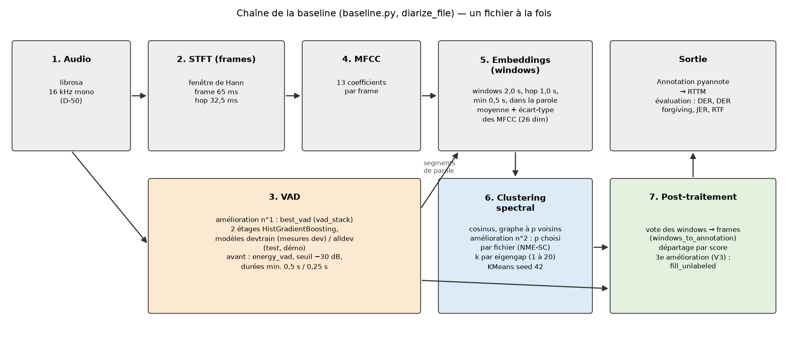

*Figure 1 — Chaîne de la baseline (`baseline.py`, version V3). Valeurs recopiées de `baseline.py`. Les cases colorées
portent les trois améliorations.*

1. **Audio** chargé avec librosa, 16 kHz mono (D-50).
2. **STFT** : frames de 65 ms, hop de 32,5 ms (`audio_features.py`).
3. **VAD** : à l'origine `energy_vad` (seuil relatif à −30 dB sous le maximum de RMS du fichier, puis durées minimales :
   silences < 0,5 s comblés, parole < 0,25 s supprimée) ; aujourd'hui `best_vad` (amélioration n°1, section 3.4).
4. **MFCC** : 13 coefficients par frame.
5. **Embeddings** : sur les segments de parole, windows glissantes de 2,0 s, hop 1,0 s, longueur minimale 0,5 s ;
   chaque window est résumée par la moyenne et l'écart-type de ses MFCC (26 dimensions, `embeddings.py`).
6. **Clustering spectral** (`clustering.py`) : similarité cosinus des embeddings centrés-réduits par fichier, graphe
   binarisé où chaque window garde ses p plus proches voisins, Laplacien normalisé, nombre de locuteurs k choisi par
   l'eigengap (entre 1 et 20), KMeans (seed 42).
7. **Post-traitement** (`post_treatment.py`, `windows_to_annotation`) : chaque frame de parole reçoit le label voté par
   les windows qui la couvrent ; une égalité est départagée par un score au centroïde. Le résultat est une
   `Annotation` pyannote, écrite en RTTM.

### 3.2 Réglage des paramètres

Chaque réglage a été fait par balayage, un paramètre à la fois, avec la VAD et le clustering de l'époque.

| Paramètre | Fichiers | Critère | Résultat observé | Valeur retenue |
|---|---|---|---|---|
| Seuil de `energy_vad` (et durées minimales) | dev sample 40 | detection error | −30 dB : 5,92 % ; −28 dB : 6,06 % ; −32 dB : 6,03 % ; « tout parole » : 9,91 % (`figures/vad_eval.png`, D-53). Minimum plat | −30 dB ; `min_silence` 0,5 s ; `min_speech` 0,25 s dans `baseline.py` (le meilleur point du balayage est à 0,30 s) |
| Taille de frame et hop de la STFT | dev sample 90 | DER moderne | toutes les combinaisons (frame 35 à 75 ms, hop 10, 25 ou 50 % de la frame) entre 33,45 % et 34,87 % ; 65 ms / 32,5 ms : 33,49 % (`results/DER_in_function_of_frames_nd hop/resume.csv`) | 65 ms / 32,5 ms. Écart d'environ 1,4 point interprété comme du bruit ; légère baisse du DER quand la frame grandit (journal de bord) |
| Taille des windows d'embedding (hop = moitié) | dev sample 90 | DER moderne | 43,90 % à 1,036 s ; 33,38 % à 2,107 s ; entre 33,8 et 34,9 % jusqu'à 3,0 s ; la confusion suit la même courbe (32,76 → 21,52 %) (`results/sweep_windows/sweep_windows_sample90_seed130_resume.csv`) | 2,0 s / hop 1,0 s (D-56) |

La taille des windows est le paramètre qui a le plus d'effet : elle agit directement sur la confusion. Les figures des
trois balayages sont en annexe (A2, A3, A4).

### 3.3 Diagnostics oracle : quel composant limite la baseline ?

Pour savoir où se perd le DER, un composant à la fois est remplacé par la vérité terrain (`baseline_oracle.py`) :
la VAD (VAD oracle), le vote des windows (vote oracle) ou le nombre de locuteurs (k oracle). Fichiers : dev sample 90.
Configuration du 11/11 : `energy_vad`, windows 2 s / 1 s, p fixe 0.1, `max_speakers` 10, KMeans seed 42.

| Composant remplacé | DER moderne | DER forgiving | JER | FA | missed | confusion |
|---|---|---|---|---|---|---|
| aucun (baseline du 11/11) | 33,49 % | 31,12 % | 63,87 % | 4,17 % | 7,77 % | 21,55 % |
| VAD | 28,67 % | 25,99 % | 61,13 % | 0,03 % | 6,87 % | 21,77 % |
| vote | 31,63 % | 29,27 % | 62,37 % | 4,17 % | 7,77 % | 19,70 % |
| k | 38,76 % | 36,29 % | 55,89 % | 4,17 % | 7,77 % | 26,82 % |

Source : recalcul avec `pyannote.metrics` (protocole de la section 2.4) depuis les RTTM d'hypothèses du commit
`4ae8849` (11/11), `figures/rapport/decomposition_oracle_dev90.csv` ; DER, FA, missed et confusion identiques à ceux du
journal de bord (`docs/notes-importantes-et-difficultes.md`).

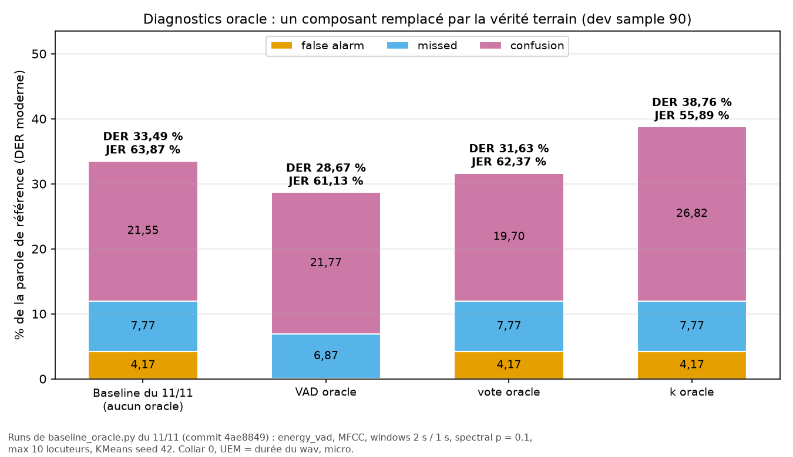

*Figure 2 — Décomposition du DER moderne pour chaque diagnostic oracle (dev sample 90, `energy_vad`, p fixe 0.1).*

**Observé.**
- La confusion vaut environ 21 à 22 points sur 33 dans tous les runs, sauf le k oracle.
- La VAD parfaite fait gagner 4,82 points, presque tous en fausses alarmes (4,17 → 0,03 %). Le missed reste à 6,87 %.
- Le vote parfait fait gagner 1,86 point, uniquement en confusion.
- Le k oracle **dégrade** le DER de 5,26 points (33,49 → 38,76 %) alors qu'il améliore le JER (63,87 → 55,89 %).

**Interprétation.** La confusion (embeddings + clustering) est le composant qui limite la baseline. La VAD coûte au plus
environ 5 points ; le vote, environ 2. Le résultat surprenant du k oracle est expliqué par un diagnostic dédié
(`results/diag_k_oracle_vs_eigengap/rapport.md`) et résumé en section 6 : avec p = 10 % des windows, les petits
locuteurs n'ont pas de groupe propre dans le graphe, et imposer le vrai k fait découper le locuteur dominant
(figure 3).

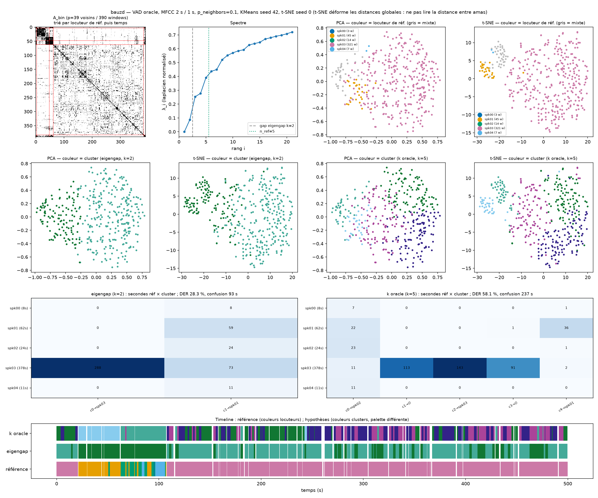

*Figure 3 — Fichier bauzd (dev sample 90, VAD oracle, p fixe 0.1, 5 locuteurs de référence), tirée de
`results/diag_k_oracle_vs_eigengap/`. L'eigengap choisit k = 2 (DER 28,3 %, 93 s de confusion). Avec k = 5, le locuteur
dominant spk03 (378 s) est coupé en trois clusters (113 s, 143 s, 91 s) et le DER monte à 58,1 % (237 s de
confusion).*

Le constat « VAD oracle = −4,82 points, surtout en FA » est ce qui a orienté le choix de l'amélioration n°1 ; le
diagnostic du k oracle a orienté l'amélioration n°2.

### 3.4 Choix des deux améliorations

Les deux améliorations ont été fixées par Grégoire le 14/11 (D-62), avant toute exécution de l'ablation sur le test.

**Amélioration n°1 : `energy_vad` → `best_vad` (`vad_stack`).** Diagnostic d'origine : la VAD coûte jusqu'à
4,82 points, surtout en FA (section 3.3). La VAD apprise a été développée par le subagent `vad-researcher`
(`results/vad_agent/rapport.md`) : deux étages de HistGradientBoosting par frame (log-mel, énergie relative, platitude,
périodicité, contexte temporel), sans réseau de neurones. Detection error : 6,649 % → 3,131 % sur le dev sample 90
(modèles devtrain) ; 11,045 % → 5,761 % sur le test sample 90 (`results/vad_agent/rapport.md`). La référence de
l'ablation est `energy_vad` sans hystérésis ni lissage de l'énergie : l'hystérésis a été abandonnée (D-54, révision du
14/11).

**Amélioration n°2 : p fixe → NME-SC.** Diagnostic d'origine : avec p fixe, un locuteur qui a moins de p windows est
absorbé par les autres, et l'eigengap sous-estime k (section 3.3). NME-SC (`nme_spectral_clustering`, D-59) teste
30 valeurs de p par fichier, entre 5 voisins et 25 % des windows, et garde celle dont le spectre est le plus net. Seul
le choix de p change ; le Laplacien reste normalisé. Sur le dev sample 90 (`best_vad` devtrain,
`results/nme_sc/agregats_sample90_seed130.csv`) :

| Variante | DER moderne | DER forgiving | JER | confusion |
|---|---|---|---|---|
| p fixe 0.02 | 29,09 % | 26,21 % | 52,91 % | 21,15 % |
| NME-SC, Laplacien normalisé (retenu) | 27,39 % | 24,48 % | 54,85 % | 19,46 % |
| NME-SC, Laplacien non normalisé | 26,04 % | 23,11 % | 55,27 % | 18,10 % |

Sur le dev, NME-SC baisse le DER mais monte le JER : contre p 0.02, il surestime moins k (21 % → 10 % des fichiers) et
le sous-estime plus (34 % → 47 %) (D-59). La variante normalisée a été retenue parce qu'elle ne change qu'un élément.

### 3.5 Organisation du travail

À partir du 12/11 (D-61), Grégoire a délégué des tâches répétitives ou chronophages à des agents Claude Code, exécutés
localement dans le dépôt. Grégoire fixe l'objectif, le protocole et les contraintes ; chaque agent rend un rapport,
ne prend aucune décision et ne consulte pas le test sans demande. Agents utilisés : `vad-researcher` (VAD apprise),
`clustering-embeddings-analyzer` (diagnostic du k oracle), `demo-builder` (démo), `confusion-improver` (section 3.6),
`project-verifier` (vérification du rendu) et `report-writer` (ce rapport). Les règles d'usage, l'évolution de la
politique d'utilisation en trois phases et la provenance de chaque fichier sont dans `docs/utilisation_claude.md`.

### 3.6 Troisième amélioration : l'agent de recherche Confusion Improver

Travail **post-ablation, sur le dev uniquement** : il ne remplace pas l'ablation et n'a justifié aucune consultation du
test. Rapport complet : `results/confusion_improver/rapport.md`.

**Mission.** Réduire la confusion, donc le DER et le JER, sans deep learning (aucun réseau de neurones, ni pré-entraîné
ni entraîné), avec des méthodes implémentées par l'agent dans son propre dossier (`experiments/confusion_improver/`),
sans modifier le code de Grégoire. Modèles statistiques autorisés (LDA, GMM, régression logistique…), jamais évalués
sur leurs fichiers d'entraînement.

**Méthode.** Des tours successifs : sélection des pistes, hypothèse mesurable, implémentation (un seul changement par
rapport à la meilleure configuration du moment), test, analyse globale et par fichier, interprétation, nouvelles
pistes. Chaque piste est évaluée sur deux ensembles :
- le dev sample 90 avec `best_vad` devtrain (modèles appris entraînés sur les 126 fichiers dev-train) ;
- all dev (216 fichiers) avec la VAD oracle (modèles appris en validation croisée à 5 folds par fichier).

Critère d'une piste « retenue » par l'agent : gain d'au moins 0,4 point de DER sans hausse du JER, ou d'au moins
2 points de JER sans hausse du DER, avec JER ≤ 2,1 × DER, **sur les deux ensembles**. Neuf tours, **48 configurations**
évaluées en DER / JER sur les deux ensembles, plus 12 jeux de caractéristiques comparés par un indicateur calculé sur
dev-train seul, deux diagnostics k oracle et des runs de stabilité sur 4 seeds.

**Un outil de recherche, pas un décideur.** L'agent propose ; il n'intègre rien dans `baseline.py`. C'est Grégoire qui
identifie, parmi les pistes qui passent les critères, les gains robustes (non dus au surapprentissage du dev, après
autant d'essais sur les mêmes fichiers) et qui choisit. Pistes passant les critères de l'agent :

| Piste | Δ DER / Δ JER, dev sample 90 | Δ DER / Δ JER, all dev (VAD oracle) | Fichiers améliorés / dégradés (s90 ; all dev) | Modèle appris sur le dev | Confiance (agent) |
|---|---|---|---|---|---|
| frames de parole sans window → label de la frame labellisée la plus proche (`fill_unlabeled`) | −0,86 / −0,38 | −1,95 / −1,12 | 41 / 4 ; 196 / 0 | non | forte |
| caractéristiques enrichies (20 MFCC, deltas, F0 ; 69 dimensions) + projection LDA à 20 dimensions | −3,03 / −9,32 | −3,50 / −7,91 | 40 / 23 ; 106 / 66 | oui (LDA) | forte sur le gain global, moyenne par fichier |
| re-segmentation (GMM par cluster, Viterbi, pénalité 20) | −1,23 / −1,75 | −0,92 / −1,28 | 47 / 9 ; 90 / 33 | non (modèles estimés sur le fichier) | moyenne à forte |
| windows 1,5 s / hop 0,75 s (LDA réentraînée) | −1,44 / −0,34 | −1,07 / −1,31 | 23 / 21 ; 63 / 50 | oui (LDA) | faible à moyenne, effet concentré |

Source : `results/confusion_improver/rapport.md` (section 3) ; chaque Δ est mesuré contre la meilleure configuration du
tour. Combinées, les quatre pistes (configuration « BEST4 ») donnent 20,83 % de DER et 43,06 % de JER sur le dev
sample 90 (contre 27,39 % et 54,85 %), et 17,60 % / 40,50 % sur all dev avec la VAD oracle (contre 25,04 % / 52,12 %).

**Choix de Grégoire.** Il a retenu **une seule piste : `fill_unlabeled`**, intégrée dans `post_treatment.py` et activée
dans `baseline.py` (`fill_unlabeled = True`) : c'est la **baseline V3**. Au regard du critère de robustesse, c'est la
piste dont le gain est le moins exposé au surapprentissage du dev :
- elle n'apprend rien sur le dev et n'a aucun paramètre réglé ;
- son mécanisme est identifié dans le code : les windows ne couvrent pas la fin des segments de parole (jusqu'à 1 s) ;
  2,10 % de la parole détectée par la VAD reste sans label sur le dev sample 90, comptée en missed ;
- elle améliore 196 fichiers sur 216 sur all dev sans en dégrader aucun.

Les trois autres pistes ne sont pas intégrées. La projection LDA et les windows 1,5 s reposent sur un modèle appris sur
le dev, et l'agent signale que des locuteurs présents dans plusieurs fichiers du dev pourraient avantager la LDA
malgré la validation croisée par fichier (hypothèse non vérifiée). Le gain des windows 1,5 s tient à peu de fichiers
(deux fichiers, ldnro et zrlyl, pèsent −1,61 point sur le dev sample 90). Ces pistes figurent en section 8.

## 4. Résultats

Tous les résultats de cette section sont sur le **test sample 90**, sauf mention contraire.

### 4.1 Ablation des deux améliorations

Protocole fixé avant l'exécution (D-62) : 4 configurations croisant les deux améliorations, tout le reste identique
(frames, MFCC, windows 2 s / 1 s, `max_speakers` 20, KMeans seed 42, post-traitement sans `fill_unlabeled`).
`best_vad` y utilise les modèles alldev. Détail complet : annexe `docs/rapport-ablation.md`.

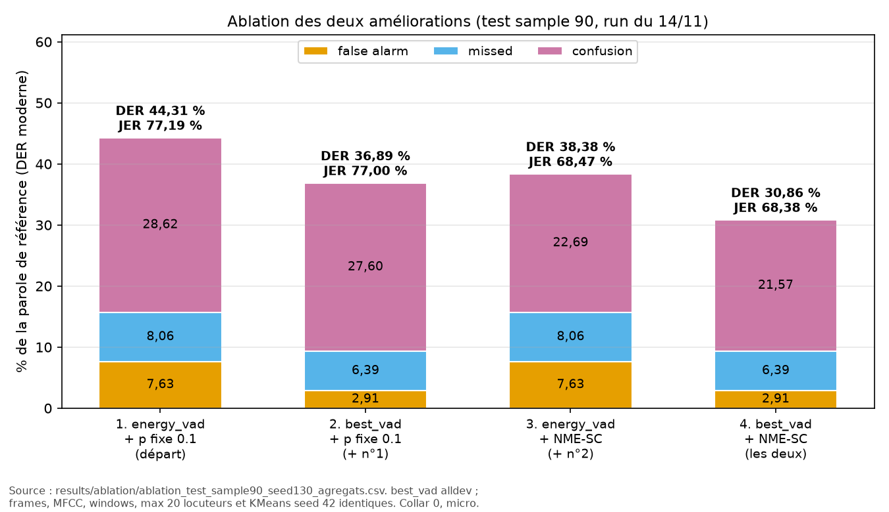

*Figure 4 — Décomposition du DER moderne des 4 configurations de l'ablation (test sample 90), d'après
`results/ablation/ablation_test_sample90_seed130_agregats.csv`.*

| Gain en DER moderne (points) | Amélioration n°1 (VAD) | Amélioration n°2 (NME-SC) |
|---|---|---|
| l'autre absente | −7,42 | −5,93 |
| l'autre présente | −7,52 | −6,03 |

**Observé** (`docs/rapport-ablation.md`).
- Ensemble : 44,31 → 30,86 % (−13,45 points de DER moderne, −14,39 de DER forgiving, −8,81 de JER). Interaction :
  −0,10 point.
- La n°1 réduit la FA (7,63 → 2,91 %) et le missed (8,06 → 6,39 %), presque pas la confusion, et ne change pas le JER
  (77,19 → 77,00 %). 74 fichiers améliorés, 11 dégradés (configurations 1 → 2).
- La n°2 réduit seulement la confusion (28,62 → 22,69 %) et le JER (77,19 → 68,47 %). 39 fichiers améliorés,
  18 dégradés (configurations 1 → 3).

**Interprétation.** Les gains s'additionnent parce que les deux améliorations corrigent des erreurs différentes :
détection de la parole (n°1) et attribution des locuteurs (n°2). L'interaction de 0,1 point est du niveau du bruit. La
n°1 est plus régulière fichier par fichier. Sur le test, la référence p = 0.1 sous-estime k ; NME-SC y améliore donc
le DER et le JER, alors que sur le dev, contre p = 0.02, il dégradait le JER (section 3.4).

### 4.2 Troisième amélioration (post-ablation) : `fill_unlabeled`

Un seul changement entre V2 et V3 : `fill_unlabeled`. V2 = `best_vad` devtrain + NME-SC + statistiques de MFCC.

| Ensemble | Version | DER moderne | DER forgiving | JER | FA | missed | confusion | Source |
|---|---|---|---|---|---|---|---|---|
| dev sample 90 | V2 | 27,39 % | 24,48 % | 54,85 % | 1,62 % | 6,32 % | 19,46 % | `results/pretrained_emb/rapport.md`, `results/baselineV2 devset/` |
| dev sample 90 | V3 | 26,53 % | 23,57 % | 54,47 % | 2,01 % | 4,67 % | 19,85 % | `results/confusion_improver/integration/run_fill.log`, `results/baselineV3 devset/` |
| all dev, VAD oracle | référence | 25,04 % | 21,72 % | 52,12 % | 0,02 % | 6,68 % | 18,34 % | `results/confusion_improver/agregats_dedup.csv` |
| all dev, VAD oracle | + `fill_unlabeled` | 23,09 % | 19,64 % | 51,00 % | 0,11 % | 3,87 % | 19,11 % | même fichier |
| test sample 90 (run informatif) | V2 | 30,77 % | 28,65 % | 67,32 % | 2,82 % | 6,88 % | 21,07 % | `docs/rapport-ablation-et-approches.md` |
| test sample 90 (run informatif) | V3 | 30,07 % | 27,93 % | 67,04 % | 3,38 % | 5,18 % | 21,51 % | même document |

**Observé.**
- Le gain est faible mais de même signe sur les trois ensembles : −0,86 point de DER sur le dev sample 90, −1,95 sur
  all dev avec la VAD oracle, −0,70 sur le test. Sur le test, 36 fichiers améliorés et 4 dégradés de plus de 0,5 point.
- Il vient du missed (6,88 → 5,18 % sur le test), au prix d'un peu de FA et de confusion : les frames ajoutées ne sont
  pas toutes de la parole (82 % le sont sur le dev sample 90, `results/confusion_improver/rapport.md`) et ne
  reçoivent pas toujours le bon label.
- k est inchangé sur les 90 fichiers du test : c'est un post-traitement.
- **Stabilité** : `fill_unlabeled` est déterministe à labels de windows donnés. Sa stabilité sur plusieurs seeds de
  KMeans n'a pas été mesurée seule ; l'agent l'a mesurée pour les configurations combinées (4 seeds : BEST3
  22,37 ± 0,08 %, BEST4 20,78 ± 0,13 % de DER sur le dev sample 90).
- **RTF** : 0,0065 (V2) et 0,0054 (V3) sur le dev sample 90 ; 0,007 et 0,0081 sur le test
  (`docs/rapport-ablation-et-approches.md`). Les écarts sont dans la variabilité des mesures de temps : pas de coût
  mesurable.

**Interprétation.** Le run V3 sur le test a été fait après le choix de `fill_unlabeled` sur le dev, à titre informatif :
il confirme le signe du gain, sans servir à choisir quoi que ce soit.

### 4.3 Approches modernes

**Embeddings WeSpeaker dans notre chaîne** (`pyannote/wespeaker-voxceleb-resnet34-LM`, option
`pretrained_embeddings = True`). Seul le vecteur de chaque window change : mêmes windows, même VAD (`best_vad`
devtrain), même clustering NME-SC. Analyse détaillée : `results/pretrained_emb/rapport.md`.
- Dev sample 90 : DER 27,39 → 14,24 %, JER 54,85 → 32,08 % ; seule la confusion change (19,46 → 6,30 %) ; 55 fichiers
  améliorés et 6 dégradés de plus d'un point.
- Test sample 90 : DER 30,77 → 17,14 %, JER 67,32 → 43,36 % ; confusion 21,07 → 7,44 % ; 72 fichiers améliorés et
  7 dégradés de plus de 0,5 point (`docs/rapport-ablation-et-approches.md`).
- Les réglages de la chaîne (windows de 2 s, NME-SC, centrage-réduction) ont été choisis avec les MFCC : la comparaison
  favorise plutôt les MFCC.

**Pipeline pré-entraîné complet** : pyannote `speaker-diarization-community-1` (`pyannote_diarization.py`, run du
07/11). Test sample 90 : DER 10,69 %, DER forgiving 9,51 %, JER 32,55 % (FA 3,62 %, missed 3,58 %, confusion 3,48 %).
Le passage de V2 + WeSpeaker à pyannote change la VAD, les embeddings, le clustering et la gestion de l'overlap à la
fois : l'écart (−6,45 points) ne peut pas être attribué à un composant précis.

**Risque de fuite (non vérifié).** `pyannote/segmentation-3.0`, inclus dans community-1, a été entraîné sur une partie
non précisée de VoxConverse (README, D-40). WeSpeaker est entraîné sur VoxCeleb, qui provient aussi de YouTube et peut
partager des locuteurs avec VoxConverse. Ce recouvrement n'a pas été vérifié : les lignes pyannote et V2 + WeSpeaker
peuvent être optimistes.

### 4.4 Tableau comparatif et cas d'échec

Test sample 90, mêmes 90 fichiers, même protocole. Version courte de `docs/rapport-ablation-et-approches.md`
(section 1), qui donne aussi la répartition de k, les écarts entre lignes voisines et la comparaison sur le dev.

| Approche | DER moderne | DER forgiving | JER | FA | missed | confusion | RTF |
|---|---|---|---|---|---|---|---|
| Plancher « un seul locuteur » | 56,66 % | 56,22 % | — | — | — | — | — |
| Baseline de départ (`energy_vad` + p fixe 0.1) | 44,31 % | 43,16 % | 77,19 % | 7,63 % | 8,06 % | 28,62 % | 0,0012 (CPU) |
| Baseline améliorée (n°1 + n°2, ablation, `best_vad` alldev) | 30,86 % | 28,77 % | 68,38 % | 2,91 % | 6,39 % | 21,57 % | 0,0079 (CPU) |
| Baseline V2 (`best_vad` devtrain + NME-SC) | 30,77 % | 28,65 % | 67,32 % | 2,82 % | 6,88 % | 21,07 % | 0,007 (CPU) |
| Baseline V3 (V2 + `fill_unlabeled`) | 30,07 % | 27,93 % | 67,04 % | 3,38 % | 5,18 % | 21,51 % | 0,0081 (CPU) |
| V2 + embeddings WeSpeaker | 17,14 % | 14,26 % | 43,36 % | 2,82 % | 6,88 % | 7,44 % | 0,019 (GPU, non représentatif) |
| pyannote `speaker-diarization-community-1` | 10,69 % | 9,51 % | 32,55 % | 3,62 % | 3,58 % | 3,48 % | 0,265 (GPU, non représentatif) |

Sources : `docs/rapport-ablation-et-approches.md` ; plancher : `results/baselineV2 testset/run.log`.

**Cas d'échec** (test sample 90, DER moderne par fichier, `docs/rapport-ablation-et-approches.md`) :
- **Baseline V3** : 26 fichiers sur 90 au-dessus de 50 % de DER. Pires cas : k = 1 sur des fichiers à nombreux
  locuteurs (qeejz, 14 locuteurs, 86,1 % ; pgtkk, 9 locuteurs, 82,5 %) ; euqef (1 locuteur, k = 4) 73,0 %. k est
  sous-estimé sur 72,2 % des fichiers.
- **V2 + WeSpeaker** : 2 fichiers au-dessus de 50 % (vylyk, 3 locuteurs, k = 1, 58,8 % ; jzkzt, 11 locuteurs, k = 6,
  51,8 %). k reste sous-estimé sur 52,2 % des fichiers.
- **pyannote** : 1 fichier au-dessus de 50 % (vylyk, 65,0 %). vylyk et jzkzt sont difficiles pour les deux approches
  pré-entraînées.
- DER médian par fichier selon le nombre de locuteurs de référence : la baseline V2 passe de 18,3 % (2-3 locuteurs) à
  43,8 % (7 locuteurs et plus) ; à partir de 2 locuteurs, V2 + WeSpeaker reste entre 16,2 % et 17,6 %, pyannote entre
  8,8 % et 10,6 %.

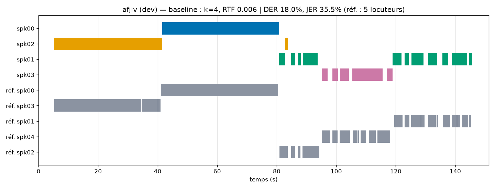
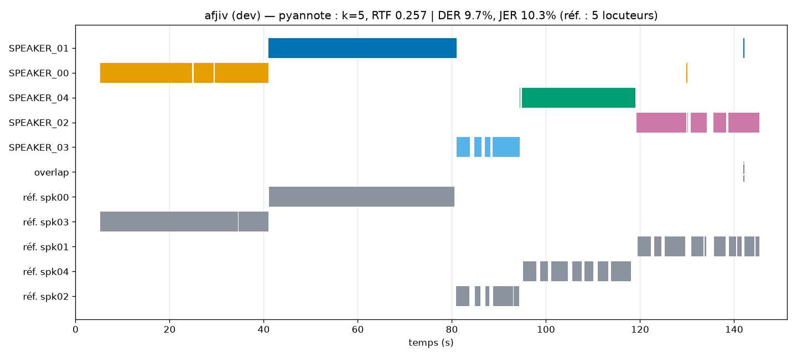

*Figure 5 — Un cas typique sur un seul fichier du dev (afjiv, 151,2 s, 5 locuteurs de référence ; hypothèses en
couleur, référence en gris), généré par la démo le 14/11 (`results/demo_agent/rapport.md`). En haut, la baseline de la
démo (`best_vad` alldev, NME-SC, avant l'ajout de `fill_unlabeled`) : k = 4, DER 18,0 %, JER 35,5 % ; elle fusionne
les locuteurs de référence spk01 et spk02. En bas, pyannote : k = 5, DER 9,7 %, JER 10,3 %. Fichier isolé, non
représentatif ; pyannote a pu voir le dev (D-40).*

**Interprétation.** La baseline échoue surtout par sous-estimation de k sur les fichiers à nombreux locuteurs : les
statistiques de MFCC séparent mal les voix proches. Les embeddings appris corrigent l'essentiel de cette confusion ;
pyannote réduit en plus le missed (6,88 → 3,58 % contre V2 + WeSpeaker). *Hypothèse non vérifiée* : cette baisse du
missed viendrait en partie de la parole superposée, que pyannote peut attribuer à deux locuteurs alors que notre
post-traitement ne donne qu'un label par frame.

### 4.5 Temps d'inférence (RTF)

- **Baseline, CPU** : RTF de 0,0012 (départ, `energy_vad`) à 0,0081 (V3) sur le test sample 90
  (`docs/rapport-ablation-et-approches.md`). `best_vad` multiplie le coût par environ 3,5 (0,0012 → 0,0042 dans
  l'ablation), mais la baseline reste plus de 100 fois plus rapide que le temps réel.
- **Le RTF de la baseline dépend de la durée** (figure 6, mesures sur des fichiers du dev). Le temps suit
  0,099 s + 0,00386 s par seconde d'audio entre 5 et 300 s (`results/demo_agent/rapport.md`, section 14). Sur les
  fichiers longs, le clustering NME-SC domine : 4,56 s sur 9,40 s pour ldnro (1 097 s), à cause de ses décompositions
  spectrales en O(n³) répétées sur 30 valeurs de p (`docs/notes-importantes-et-difficultes.md`).
- **WeSpeaker et pyannote, GPU** : RTF 0,019 et 0,265 sur le test sample 90. **Ces valeurs ne sont pas
  représentatives** : sur ce PC, le GPU (RTX 3050 Laptop) reste bloqué en mode idle. Sur CPU, pyannote a été mesuré à
  un RTF de 0,946 sur afjiv (dev, 151,2 s, `results/demo_agent/rapport.md`, section 7). Le RTF de WeSpeaker sur CPU
  n'a pas été mesuré.

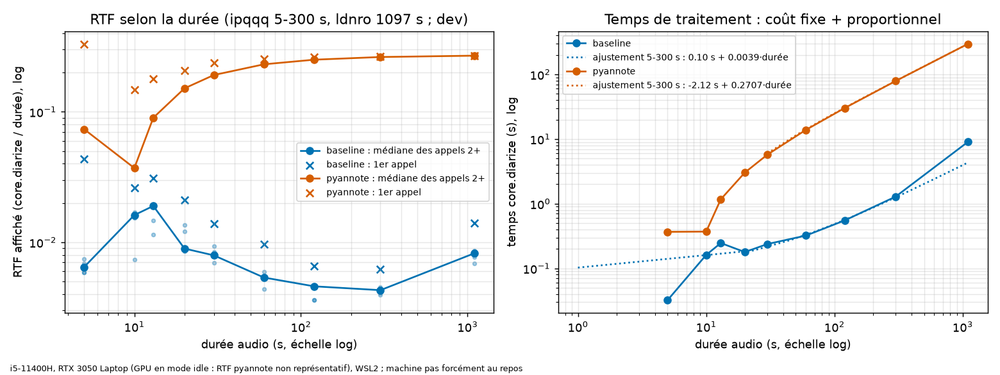

*Figure 6 — RTF (à gauche) et temps de traitement (à droite) selon la durée de l'audio, pour la baseline et pyannote
dans la démo (extraits d'ipqqq de 5 à 300 s et ldnro de 1 097 s, fichiers du dev ; i5-11400H, GPU en mode idle). Source :
`results/demo_agent/rtf_tests/`.*

## 5. Démonstration

Application Gradio locale (`demo/`, construite par le subagent `demo-builder`, choix de conception de Grégoire,
D-70 à D-76). Instructions complètes dans le `README.md` (section « Démo »).

```bash
source .venv/bin/activate
python -m demo.app          # puis ouvrir http://127.0.0.1:7860
```

**Fonctions** (`results/demo_agent/rapport.md`, section 4) :
- charger un audio (wav et flac directement ; mp3, m4a, ogg… convertis en wav 16 kHz mono par ffmpeg) ou enregistrer
  au micro ;
- choisir le pipeline : baseline (embeddings statistiques de MFCC ou WeSpeaker) ou pyannote ;
- afficher la timeline des locuteurs, leurs temps de parole et le tableau des segments ; écouter un segment ;
- renommer les locuteurs ; exporter en **RTTM** (le format JSON n'a pas été retenu, D-70) ;
- avec un RTTM de référence : timeline de référence, DER, DER forgiving, JER, FA / missed / confusion ;
- comparer baseline et pyannote sur le même fichier.

La démo fonctionne hors ligne (`HF_HUB_OFFLINE=1`, modèles en cache) et n'écoute que sur `127.0.0.1` (D-05, D-73).
Sa baseline appelle `baseline.diarize_file` avec `best_vad` alldev (D-72).

**Fichiers sur lesquels elle a été testée** (dev uniquement, `results/demo_agent/rapport.md`, sections 5 à 7 et 14) :
afjiv (151,2 s, et extraits de 1,5 s, 13 s, en flac stéréo 44,1 kHz, m4a et mp3), cqaec converti en m4a
(« réunion inconnue », 224,6 s), abjxc (un seul locuteur), pqmho (musique), ldnro (1 097,3 s, 15 locuteurs), qzwxa,
extraits d'ipqqq ; silence et bruit blanc synthétiques ; fichiers corrompus ou vides. Les 16 tests de
`tests/test_demo.py` passent ; deux d'entre eux vérifient sur hqyok et tucrg que la démo redonne exactement la sortie
de `baseline.diarize_file`. Le clic sur un segment et le micro n'ont pas été testés par l'agent (pas de navigateur).

## 6. Problèmes rencontrés et solutions

Problèmes techniques et scientifiques **résolus ou contournés**. Source principale : journal de bord
`docs/notes-importantes-et-difficultes.md`. Les problèmes non résolus sont en section 8.

| Problème observé | Hypothèse(s) | Cause trouvée | Solution | Leçon |
|---|---|---|---|---|
| Téléchargement de VoxConverse long et instable : site d'Oxford indisponible pour l'audio, connexion coupée environ tous les 1 Go | serveur instable | coupures côté serveur | miroir KAIST, reprises avec `wget -c`, vérification MD5 (environ 4 h au total) | prévoir du temps ; toujours vérifier l'intégrité (README, section « Données ») |
| 464 fichiers `.wav` dans le test au lieu de 232 | double dézippage (écartée) | le zip contient un dossier `__MACOSX/` avec 232 faux fichiers `._*.wav` | ne pointer que sur `voxconverse_test_wav/` (D-12) | compter les fichiers après chaque extraction |
| WSL plante en lançant la baseline sur tous les fichiers | manque de RAM | tous les audio et STFT chargés en même temps (7 Go de RAM) | un fichier à la fois, libération de la STFT dès que les MFCC sont calculés (`diarize_file`) | concevoir la boucle pour la machine réelle |
| DER initial très élevé (« DER horrible sur la baseline (50%) », journal de bord) | embeddings trop bruités ; clustering spectral instable | windows d'embedding trop courtes (1,0 s, D-55) pour des statistiques de MFCC stables | windows doublées, puis balayage : 43,90 % à 1,036 s → 33,38 % à 2,107 s (D-56) | la représentation des windows compte plus que le réglage du clustering |
| Le k oracle dégrade le DER (33,49 → 38,76 %) mais améliore le JER (dev sample 90) | embeddings bruités qui forcent des clusters artificiels ; clustering en cause | avec p = 10 % des windows, 172 locuteurs sur 379 ont moins de p windows et n'ont pas de bloc dans le graphe ; imposer k fait découper le dominant (1,28 → 2,96 clusters en moyenne sur les 50 fichiers sous-estimés), et l'appariement un à un compte ces morceaux en confusion (`results/diag_k_oracle_vs_eigengap/rapport.md`) | p choisi fichier par fichier (NME-SC, amélioration n°2) | un oracle partiel n'est pas un plafond ; DER et JER peuvent varier en sens inverse |
| tucrg (concert) : DER 474,2 % avec k juste (3) en mode k oracle | la musique est prise pour de la parole | `energy_vad` marque la musique forte comme parole | contourné par `best_vad` : DER 48,1 %, mais k = 1 (réf. 3) | un k « juste » peut l'être par hasard (la musique comptée comme locuteur) |
| DER de la baseline optimiste sur le dev (26,43 % au lieu de 27,39 %) | — | `best_vad` alldev évalué sur des fichiers vus à l'entraînement (relevé par le diagnostic du k oracle) | `best_vad(train="devtrain")` pour toute mesure sur le dev (D-57) | un modèle appris impose un découpage entraînement / évaluation explicite |
| pyannote : échec sur un mp3 à 48 kHz dans la démo (« resulted in 478895 samples instead of the expected 480000 ») | lecture directe du format | lecture directe du mp3 par pyannote | conversion de tout format autre que wav / flac en wav 16 kHz par ffmpeg (D-74) | même entrée pour les deux pipelines |
| RTTM pyannote du test vide (0 octet) au moment du tableau comparatif | — | fichier vide dans `results/pyannote/` ; le RTTM d'origine était dans l'historique git | restauré depuis le commit `435fa6c`, agrégats recalculés sans relancer pyannote (écart max de DER par fichier 3e-05) | garder les RTTM d'hypothèses, pas seulement les agrégats |
| RTF de la baseline plus élevé dans la démo (environ 0,011 sur 13 s) que dans les expériences (médiane 0,0049) | format m4a ; chauffe ; modèles de VAD | coût fixe sur les fichiers courts, dû surtout aux 12 threads OpenMP / OpenBLAS, plus le premier appel du processus (`results/demo_agent/rapport.md`, section 14) | cause établie ; 4 threads mesurés à RTF 0,0040 sur le même fichier, sorties identiques ; limite décidée (D-77), application en section 8 | mesurer le RTF sur des fichiers de durée comparable |
| Confusion Improver : runs ralentis à plusieurs processus | — | sur-souscription des threads BLAS | 1 thread BLAS par processus, 6 processus (`results/confusion_improver/rapport.md`) | fixer les threads en calcul parallèle |

## 7. Validité de l'évaluation

**Consultations du test** (recensement de `docs/rapport-ablation-et-approches.md`), dans l'ordre :
1. 07/11 : pyannote, run comparatif ;
2. 09/11 : baseline V0, informatif ; il a servi au plancher « un seul locuteur » ;
3. avant le 14/11 : VAD seule, subagent `vad-researcher`, 4 consultations, version fixée avant chaque exécution, aucun
   choix fait d'après le test (`results/vad_agent/rapport.md`) ;
4. 14/11 : ablation, run comparatif, protocole et versions figés avant l'exécution (D-62) ;
5. 16/11 : baselines V2 et V3, runs informatifs, après le choix des versions sur le dev ;
6. 16/11 : V2 + WeSpeaker, run comparatif, version fixée avant l'exécution.

Aucun paramètre ni aucune variante n'a été choisi d'après ces runs. Ce rapport n'a lancé aucun nouveau run sur le test :
ses chiffres de test sont relus dans les fichiers existants.

**Réglages sur le dev sample 90.** Seuil de VAD (sur le sample 40), frames, windows, p et NME-SC ont été réglés sur le
dev ; les chiffres du dev sont donc optimistes pour ces réglages. Observé : V2 obtient 27,39 % sur le dev sample 90 et
30,77 % sur le test sample 90. *Hypothèse non vérifiée* : l'écart vient à la fois de ce réglage sur le dev et du test,
qui a plus de locuteurs par fichier. Les réglages faits avec les MFCC ont été réutilisés tels quels pour WeSpeaker.

**Modèles appris.** `best_vad` : modèles devtrain sur le dev, alldev sur le test. L'ablation utilise alldev, les
baselines V2 et V3 devtrain : sur le test, passer d'alldev à devtrain change le DER de −0,09 point, avec autant de
fichiers améliorés que dégradés (`docs/rapport-ablation-et-approches.md`).

**Modèles pré-entraînés.** Recouvrement possible avec VoxConverse pour pyannote (segmentation entraînée en partie sur
VoxConverse) et pour WeSpeaker (VoxCeleb, locuteurs possiblement communs) : non vérifié (section 4.3).

**RTF.** Les RTF GPU (WeSpeaker, pyannote) ne sont pas représentatifs : GPU bloqué en mode idle sur ce PC. Les RTF
CPU dépendent de la durée des fichiers et du nombre de threads (section 4.5).

**Stabilité.** Une seule seed de KMeans (42) et un seul sample de 90 fichiers pour l'ablation et le tableau
comparatif : pas d'intervalle de confiance. Les écarts de l'ordre de 0,1 point (interaction de l'ablation, alldev
contre devtrain) relèvent du bruit. La stabilité de NME-SC sur plusieurs seeds n'a pas été vérifiée. Pour le Confusion
Improver, la stabilité a été vérifiée sur 4 seeds (42, 0, 1, 2) : écart-type de 0,13 point au plus sur le DER du dev
sample 90.

**Les 48 configurations du Confusion Improver.** Tester autant de pistes sur les mêmes fichiers expose à des gains dus
au hasard.
- Ce qui a été fait pour limiter la surévaluation : confirmation obligatoire sur deux ensembles (dev sample 90 avec la
  VAD réelle, all dev avec la VAD oracle) ; modèles appris toujours évalués sur des fichiers non vus (dev-train pour le
  sample 90, validation croisée à 5 folds par fichier pour all dev) ; pas de balayage fin d'un paramètre ; nombre de
  configurations compté et publié ; stabilité sur 4 seeds ; sélection par Grégoire de la seule piste sans modèle
  appris ni paramètre réglé, qui ne dégrade aucun fichier sur all dev.
- Ce qui reste : tous les essais réutilisent les mêmes fichiers du dev ; pour des variantes d'embedding proches, le
  sample 90 et all dev donnent souvent des signes opposés (écarts de 1 à 2 points à lire comme du bruit) ; all dev est
  mesuré avec la VAD oracle ; un locuteur présent dans plusieurs fichiers du dev pourrait avantager la LDA ; les
  configurations non retenues (BEST3, BEST4) n'ont jamais été mesurées sur le test.

## 8. Limites du système et pistes d'amélioration

Statuts : *testée retenue* / *testée rejetée* / *non testée*. Les pistes du Confusion Improver sont marquées
**(post-ablation, dev uniquement)**.

| Limite observée | Preuve (chiffre, fichier) | Piste | Statut | Source |
|---|---|---|---|---|
| La confusion domine l'erreur de la baseline | 21,51 points sur 30,07 (V3, test sample 90) | embeddings appris WeSpeaker à la place des statistiques de MFCC | testée retenue, comme option `pretrained_embeddings` (confusion 21,07 → 7,44 % sur le test) | `docs/rapport-ablation-et-approches.md` |
| idem | 19,46 % de confusion (V2, dev sample 90) | caractéristiques enrichies + projection LDA 20 (post-ablation, dev uniquement) | testée, non retenue par Grégoire (modèle appris sur le dev) ; DER −3,03 / JER −9,32 sur le dev sample 90 | `results/confusion_improver/rapport.md` |
| idem | idem | projection WCCN complète (post-ablation, dev uniquement) | testée rejetée par l'agent (JER en hausse contre la LDA 20) | idem |
| idem | idem | AHC à seuil appris, sur-segmentation puis fusion apprise (post-ablation, dev uniquement) | testées rejetées (DER +10,95 et +10,70 sur le dev sample 90) | idem |
| idem | idem | scoring PLDA, supervecteurs GMM-UBM | non testée | idem |
| k sous-estimé sur la majorité des fichiers à nombreux locuteurs | 72,2 % des fichiers (V3, test) ; qeejz (14 locuteurs) : k = 1, DER 86,1 % | règle de choix de k apprise ; continuité temporelle dans le graphe (post-ablation, dev uniquement) | règle apprise non testée ; continuité testée, non tranchée (signes opposés entre les deux ensembles) | `docs/rapport-ablation-et-approches.md`, `results/confusion_improver/rapport.md` |
| Tout ce qui augmente k améliore le JER et dégrade le DER | k oracle : DER 33,49 → 38,76 %, JER 63,87 → 55,89 % (dev sample 90) ; NME-SC sur le dev : JER +1,9 point | aucune piste testée n'a isolé les petits locuteurs sans morceler le dominant | non résolu | `results/diag_k_oracle_vs_eigengap/rapport.md`, `results/confusion_improver/rapport.md` |
| Résolution d'environ 1 s aux changements de locuteur (vote des windows) | vote oracle : −1,86 point (dev sample 90) | re-segmentation GMM / Viterbi (post-ablation, dev uniquement) | testée, non retenue par Grégoire ; DER −1,23 sur le dev sample 90 | `results/confusion_improver/rapport.md` |
| Windows de 2 s souvent mixtes | balayage des windows (section 3.2) | windows 1,5 s / hop 0,75 s avec LDA (post-ablation, dev uniquement) | testée, non retenue par Grégoire ; gain concentré sur 2 fichiers | idem |
| Parole superposée : un seul label par frame | missed 5,18 % (V3, test) contre 3,58 % pour pyannote | attribuer un second locuteur dans les zones d'overlap | non testée | `docs/rapport-ablation-et-approches.md` |
| Fausses alarmes sur musique et bruit de foule | pires fichiers du test pour la VAD : wprog, wemos, uicid, diysk, bgvvt ; sans eux, detection error 4,671 % au lieu de 5,434 % | apprendre la VAD avec un corpus de musique et de bruit (ex. MUSAN) | non testée | `results/vad_agent/rapport.md` |
| Plateau de la VAD aux frontières | environ 0,7 point d'erreur à ±50 ms des frontières de référence | HMM, augmentation, ensemble | testées rejetées (aucun gain) | `results/vad_agent/rapport.md` |
| Coût du clustering cubique sur les fichiers longs | clustering 4,56 s sur 9,40 s pour ldnro (1 097 s) | réduire la grille NME-SC ou le nombre de windows | non testée | `results/demo_agent/rapport.md`, `docs/notes-importantes-et-difficultes.md` |
| RTF de la démo gonflé sur les fichiers courts | RTF 0,0111 avec 12 threads, 0,0040 avec 4 threads (afjiv, 13 s) | limiter la démo à 4 threads (D-77) | décidée, pas encore appliquée dans `demo/` | `docs/choix_techniques.md`, `results/demo_agent/rapport.md` |
| Stabilité non mesurée pour l'ablation | une seule seed de KMeans, un seul sample | répéter l'ablation sur plusieurs seeds ; mesurer NME-SC sur all dev | non testée | `docs/rapport-ablation.md` |
| Diagnostics oracle non comparables à la baseline actuelle | `baseline_oracle.py` utilise encore `best_vad` alldev, p 0.1, `max_speakers` 10 | aligner `baseline_oracle.py` sur `baseline.py` | non fait | `README.md` |

## 9. Index des documents

### Rendu

| Document | Contenu | Sections du rapport |
|---|---|---|
| `README.md` | installation, données, lancement de la baseline, des scripts et de la démo, modèles pré-entraînés et licences | 2.1, 4.3, 5, 8 |
| `docs/decision_corpus.md` | choix de VoxConverse face à AMI, risques de fuite | 2.1 |
| `docs/corpus/voxconverse.md` | fiche du corpus principal : accès, licence, volume, annotations, limites | 2.1 |
| `docs/corpus/ami.md` | fiche du corpus alternatif | 2.1 |
| `docs/choix_techniques.md` | décisions D-xx : données, protocole, baseline, améliorations, démo | 2, 3, 5, 6, 7, 8 |
| `docs/rapport-ablation-et-approches.md` | tableau comparatif sur le test sample 90, écarts, cas d'échec, comparaison sur le dev, recensement des runs sur le test | 1, 4.2, 4.3, 4.4, 4.5, 6, 7, 8 |
| `docs/utilisation_claude.md` | usage de Claude, délégation aux agents, provenance des fichiers | 3.5 |
| `docs/notes-importantes-et-difficultes.md` | journal de bord : difficultés, diagnostics, observations | 3.2, 3.3, 4.5, 6, 8 |

### Annexe

| Document | Contenu | Sections du rapport |
|---|---|---|
| `docs/rapport-ablation.md` | ablation des deux améliorations : protocole, agrégats, gains, décomposition, fichier par fichier | 4.1, 8 |

### Sources citées (hors rendu)

| Document | Contenu | Sections du rapport |
|---|---|---|
| `results/vad_agent/rapport.md` | VAD apprise `vad_stack` / `best_vad` : protocole, résultats, limites | 3.4, 7, 8 |
| `results/diag_k_oracle_vs_eigengap/rapport.md` | pourquoi le k oracle dégrade le DER | 3.3, 6, 8 |
| `results/pretrained_emb/rapport.md` | WeSpeaker contre statistiques de MFCC sur le dev sample 90 | 4.2, 4.3 |
| `results/demo_agent/rapport.md` | démo : architecture, fonctions, tests, temps et RTF | 4.4, 4.5, 5, 6, 8 |
| `results/confusion_improver/rapport.md` | agent Confusion Improver : pistes, résultats, stabilité | 3.6, 4.2, 6, 7, 8 |

Fichiers de résultats cités : `results/ablation/`, `results/nme_sc/`, `results/sweep_windows/`,
`results/DER_in_function_of_frames_nd hop/`, `results/baselineV2 devset/`, `results/baselineV3 devset/`,
`results/baselineV2 testset/`, `results/baselineV3 testset/`, `results/baselineV2 pretrained embeddings testset/`,
`results/pyannote/`, `results/confusion_improver/` ; figures et script du rapport : `figures/rapport/`.

## 10. Annexe : figures

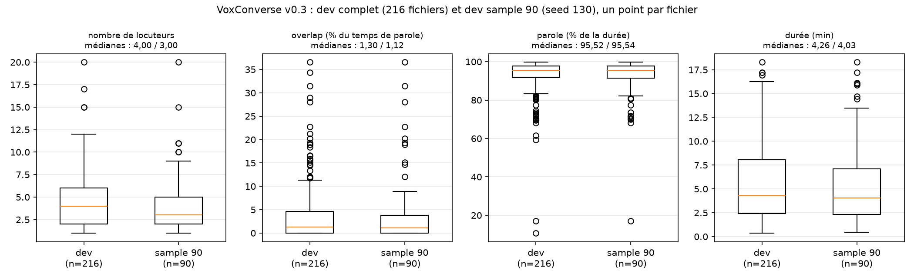

*Figure A1 — Représentativité du dev sample 90 : distributions par fichier du dev complet (216 fichiers) et du sample
90 (seed 130), pour le nombre de locuteurs, le taux d'overlap, la part de parole et la durée. Données :
`figures/voxconverse_file_stats.csv` (lignes du dev) ; tests chiffrés : `figures/sample_vs_dev_smd_ks.csv`
(section 2.2).*

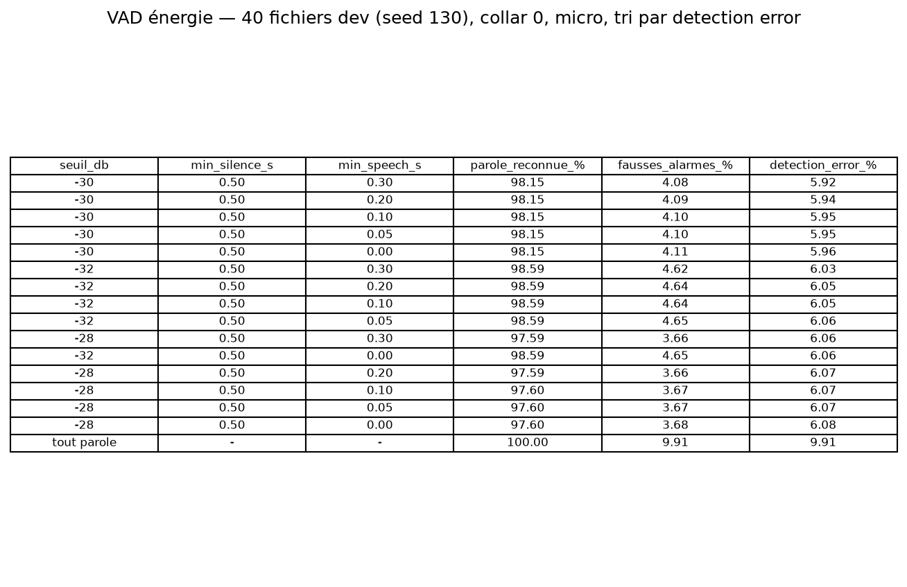

*Figure A2 — Balayage du seuil et des durées minimales de `energy_vad` (dev sample 40, seed 130) : les 15 meilleures
combinaisons triées par detection error, et la VAD « tout parole » (section 3.2).*

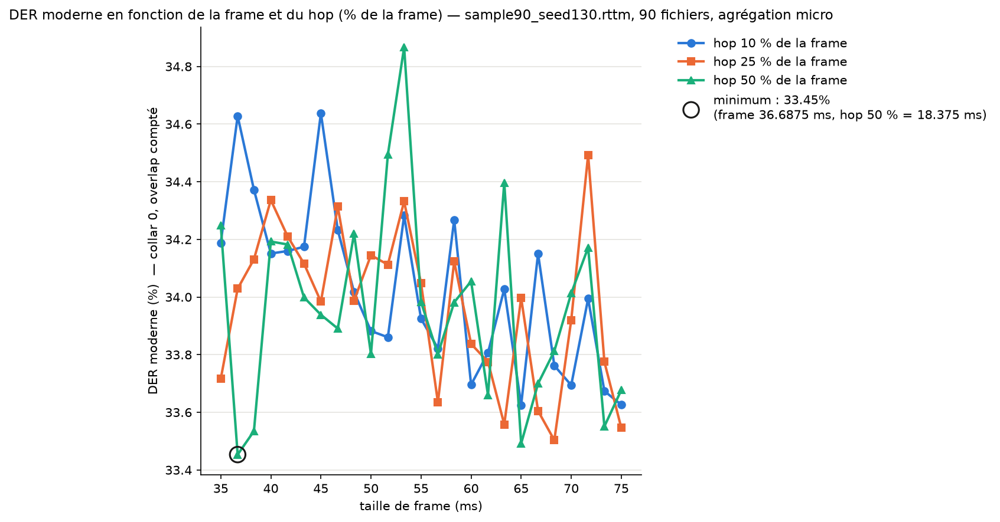

*Figure A3 — DER moderne selon la taille de frame (35 à 75 ms) et le hop (10, 25, 50 % de la frame), dev sample 90 :
toutes les valeurs restent entre 33,45 % et 34,87 % (section 3.2).*

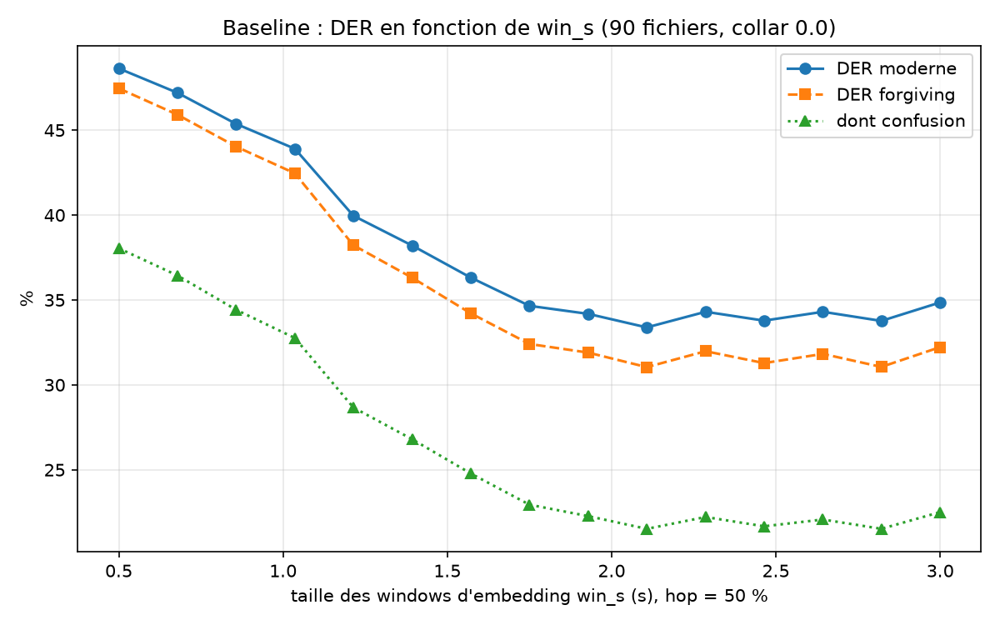

*Figure A4 — DER moderne, DER forgiving et confusion selon la taille des windows d'embedding (0,5 à 3,0 s, hop = 50 %),
dev sample 90 : le DER baisse jusqu'à 2 s puis se stabilise (section 3.2).*
